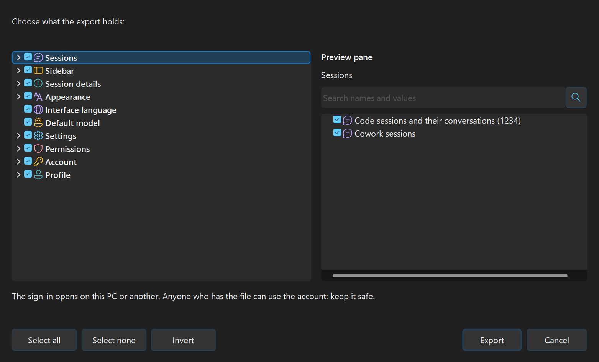

# Claude Delta

Several Claude Desktop accounts on one Windows PC, open at the same time, each in its own window with its own sign-in, chats, Claude Code sessions and settings.

Claude Delta is an unofficial tool. It is not made by Anthropic, and it never changes Claude Desktop: it starts the Claude you already have installed, once per profile.

## 关于这个版本 / About this version

这是 [leiyitong](https://github.com/leiyitong) 公开分享的版本。程序最初由 [Freenitial](https://github.com/Freenitial)（Léo Gillet）编写，名叫 Claude Desktop Profiles Manager；之后由 Cheese（[JustLikeCheese](https://github.com/JustLikeCheese)）在一个不公开的仓库里继续开发，改名为 Claude Delta。这个仓库发布 Cheese 的最新版本，方便公开分享，并且只从这个仓库检查更新。

leiyitong 提交、已经被 Cheese 采纳的改进：几个账号保持同样的对话（不用链接文件夹）、会话保险库、恢复删除的对话、每周自动备份 `.claude`、保险库自动清理、帮助，以及修复"对话太长换新记录文件后被同步删除"的问题。

This is the version [leiyitong](https://github.com/leiyitong) shares publicly: Cheese's latest version of the program written by [Freenitial](https://github.com/Freenitial) (Léo Gillet), which Cheese ([JustLikeCheese](https://github.com/JustLikeCheese)) develops in a private repository as Claude Delta. It checks for updates in this repository only.

### 怎么安装 / How to install

1. 先安装 [Claude Desktop](https://claude.ai/download)（Windows 10 1809 或更新的 64 位系统）
2. 打开本仓库的 **[Releases](../../releases/latest)**，下载 **`ClaudeDesktopProfilesManager.exe`**（不要下载 "Source code"，那是源代码）
3. 双击运行。它不需要安装包，也不需要管理员权限：会自己装到 `%LOCALAPPDATA%\Programs\Claude Desktop Profiles Manager`，在开始菜单加上快捷方式，然后打开。下载的那个文件之后可以删掉
4. Windows 问"用哪个应用打开 claude:// 链接"时，选 **Claude Delta**，再选**始终**

这个版本没有数字签名，所以第一次运行时 Windows 可能显示"Windows 已保护你的电脑"：点**更多信息** → **仍要运行**。有新版本时，管理器会提示你，并打开下载页面，按上面的步骤再装一次即可。

Download `ClaudeDesktopProfilesManager.exe` from [Releases](../../releases/latest) and double-click it: it installs itself for the current user. It is not signed, so Windows SmartScreen may ask first: **More info** → **Run anyway**.

## What you get

**Profiles side by side**
- Make as many profiles as you need (Work, Client, Research…), each with a name, a color or a picture, and an optional note.
- Every profile gets its own icon: a colored badge on its desktop shortcut, its taskbar button, its Alt+Tab thumbnail and its notification-area icon.
- Open, quit or restart one profile, or several at once. The list shows which ones are running.
- Any profile can open when you sign in to Windows.

**Links and sign-in**
- `claude://` links go to the right window: when several profiles are open, Claude Delta asks which one, with the likely one already chosen.
- **Private sign-in** opens claude.ai in a clean window of its own, with no account signed in, so you can sign a new profile in to a different account. Once you are signed in, the profile opens already signed in.

**Claude Code sessions**
- The **Sessions view** lists every profile's Code sessions: search titles, folders and whole conversations, filter and group them as Claude does, preview a conversation, rename, pin, delete.
- Copy or move sessions to another profile, share one between profiles, or keep several profiles' sessions in sync. Undo with Ctrl+Z.
- A session vault keeps every version of each profile's session list, so a session Claude dropped can be recovered.

**Back up and move**
- **Export** a profile into one archive, choosing exactly what it holds, and **Import** it into another profile or onto another PC. **Sync settings** keeps chosen settings the same across profiles.

**More for Claude**
- **Windows MCP** lets Claude work this PC's apps and windows, in the profiles you choose. Press Esc while it acts to stop it.
- **SearXNG search** lets Claude search the web through your own SearXNG instance. It needs Node.js.

**Shield**
- A badge in the corner watches the network address Claude is reached from: the country, whether it is a datacenter address, DNS, WebRTC and IPv6 leaks. It can stop Claude when something looks wrong, or only warn.

**Small and self-contained**
- One native program, no runtime, no administrator rights. It installs for your Windows account only.
- English and Simplified Chinese, following Windows or your choice in **Settings**.

## Requirements

- Windows 10 version 1809 or later, 64-bit
- [Claude Desktop](https://claude.ai/download), from claude.ai or the Microsoft Store

## Install

1. Download **[ClaudeDesktopProfilesManager.exe](../../releases/latest/download/ClaudeDesktopProfilesManager.exe)** from the latest release.
2. Run it. It installs itself into `%LOCALAPPDATA%\Programs\Claude Desktop Profiles Manager` and adds itself to the Start menu.

To remove it, use Windows Settings → Apps. It asks which profiles to keep; the others go to the Recycle Bin. Claude Desktop itself is left as it is.

## First steps

1. Click **New…**, give the profile a name and a color, and click **OK**. It opens in a window of its own.
2. Sign in to Claude in that window, or use **Private sign-in** from the profile's right-click menu to sign in to another account.
3. Open **Shortcuts** to put the profile on the desktop, the taskbar or the Start menu.
4. Optionally select a profile and click **Set as default**: it opens `claude://` links while Claude is closed.

Right-click a profile for everything else it can do.

## Good to know

- The regular Claude icon always opens the profile called Main, which is Claude's own folder (`%APPDATA%\Claude`). The other profiles live in `%APPDATA%\Claude-<name>`.
- Claude Code's settings and memory (`%USERPROFILE%\.claude`) are shared by every profile; Claude Desktop's own settings, MCP servers and extensions belong to each profile.
- Cowork can run in one profile at a time: its virtual machine belongs to the whole PC.
- When Claude updates itself it closes every profile; Claude Delta opens them again afterwards.
- Updates: Claude Delta tells you when this repository has a new release and opens its download page (its releases are not signed, so it does not install them by itself).

## When something goes wrong

| What you see | What to try |
|---|---|
| A sign-in finishes in the browser, but the window stays signed out | Start the sign-in again from that window and send the link to the profile Claude Delta names, or use **Private sign-in** |
| Windows asks which app opens a Claude link | Choose **Claude Delta** and **Always** |
| Something stopped working after an update | Click **Repair** |
| Anything else | Look at the log, `%LOCALAPPDATA%\Claude Desktop Profiles Manager\claude-desktop-profiles-manager.log`, or **About → Open logs** |

## More

- How it works, in detail: [docs/HOW-IT-WORKS.md](docs/HOW-IT-WORKS.md)
- What changed, day by day: [CHANGELOG.md](CHANGELOG.md) · [简体中文](CHANGELOG.zh-CN.md)
- Building it yourself: [BUILD.md](BUILD.md)

## License

Open source, except the Taskbar Module (`src/taskbar.c` and `src/taskbar-pin.c`), whose enterprise or commercial use needs a paid license. See [LICENSE](LICENSE). Contact: [freenitial@gmail.com](mailto:freenitial@gmail.com)

## Credits

- [Freenitial](https://github.com/Freenitial) (Léo Gillet), the original Claude Desktop Profiles Manager
- Cheese ([JustLikeCheese](https://github.com/JustLikeCheese)), its further development as Claude Delta
- [ai-multi-instance](https://github.com/Zoltak-Dev/ai-multi-instance), for running Claude Desktop with a data folder of its own
- [claude-desktop-clone](https://github.com/vodongha/claude-desktop-clone) and [claude-windows-multiprofile](https://github.com/fredless/claude-windows-multiprofile), earlier tools for the same job
