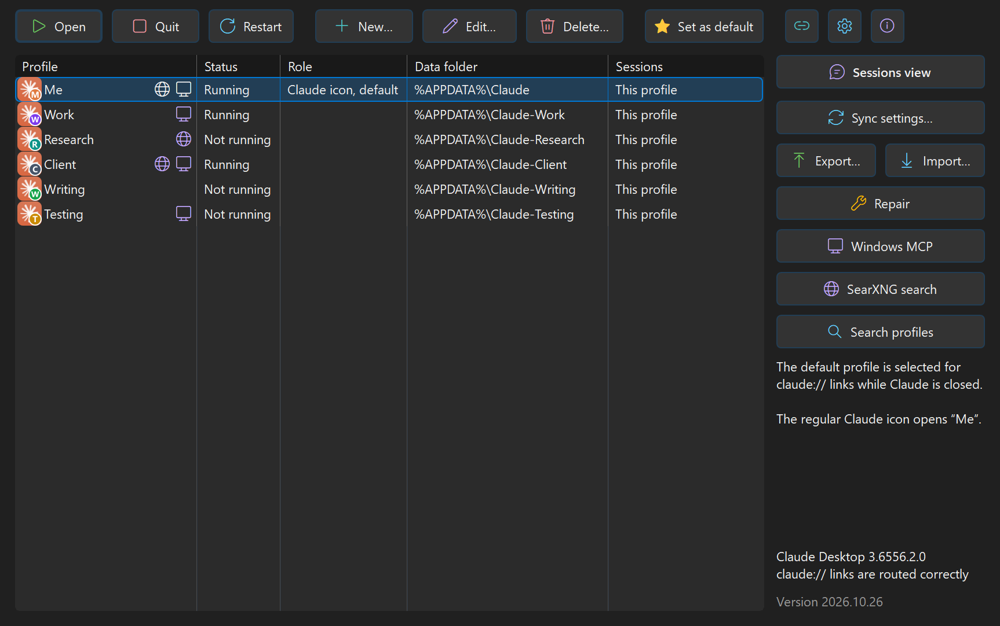

# Claude Desktop Profiles Manager

Run several Claude Desktop accounts side by side on Windows, each with **its own sign-in, history and settings**.

Unofficial tool, not affiliated with Anthropic.

## 关于这个版本 / About this version

这是 [leiyitong](https://github.com/leiyitong) 公开分享的版本。程序最初由 [Freenitial](https://github.com/Freenitial)（Léo Gillet）编写，之后由 Cheese（[JustLikeCheese](https://github.com/JustLikeCheese)）在一个不公开的仓库里继续开发。这个仓库发布 Cheese 的最新版本，方便公开分享，并且只从这个仓库检查更新。

leiyitong 提交、已经被 Cheese 采纳的改进：几个账号保持同样的对话（不用链接文件夹）、会话保险库、恢复删除的对话、每周自动备份 `.claude`、保险库自动清理、帮助，以及修复"对话太长换新记录文件后被同步删除"的问题。

This is the version [leiyitong](https://github.com/leiyitong) shares publicly: Cheese's latest version of the program written by [Freenitial](https://github.com/Freenitial) (Léo Gillet), which Cheese ([JustLikeCheese](https://github.com/JustLikeCheese)) develops in a private repository. It checks for updates in this repository only.

### 怎么安装 / How to install

1. 先安装 [Claude Desktop](https://claude.ai/download)（Windows 10 1809 或更新的 64 位系统）
2. 打开本仓库的 **[Releases](../../releases/latest)**，下载 **`ClaudeDesktopProfilesManager.exe`**（不要下载 "Source code"，那是源代码）
3. 双击运行。它不需要安装包，也不需要管理员权限：会自己装到 `%LOCALAPPDATA%\Programs\Claude Desktop Profiles Manager`，在开始菜单加上快捷方式，然后打开。下载的那个文件之后可以删掉
4. Windows 问"用哪个应用打开 claude:// 链接"时，选 **Claude Desktop Profiles Manager**，再选**始终**

这个版本没有数字签名，所以第一次运行时 Windows 可能显示"Windows 已保护你的电脑"：点**更多信息** → **仍要运行**。有新版本时，管理器会提示你，并打开下载页面，按上面的步骤再装一次即可。

Download `ClaudeDesktopProfilesManager.exe` from [Releases](../../releases/latest) and double-click it: it installs itself for the current user. It is not signed, so Windows SmartScreen may ask first: **More info** → **Run anyway**.

## Features

- **Profile manager** - Lists existing profiles; creates, renames, recolors and deletes them (to the Recycle Bin)
- **Link chooser** - With several profiles, Claude Desktop Profiles Manager asks which one opens a `claude://` link; for a browser sign-in, the window that started it is already selected
- **Notifications** - A Claude notification clicked in Windows' notification center opens the profile that showed it, not the default one: with several profiles open, you pick which
- **Window title** - A profile's window shows its own name and icon in the taskbar's thumbnail and in Alt+Tab: `Claude (<name>)`, or a title of your own (**Title** in **Edit…**), changed at once on a running profile
- **Profile badges** - Each profile's shortcut and taskbar button show the Claude icon with its own colored badge, and its notification-area icon takes its color (or its picture, below). Twenty colors, the ones no profile uses listed first and the others with the profiles that use them; a badge shows the name's initial or one or two characters of your own; or a picture of your own (PNG, JPEG, GIF, BMP, TIFF, ICO, and WebP or HEIF with their Windows extension) replaces the icon
- **Toolbar and column** - A toolbar with colored icons: **Open**, **Quit**, **Restart**, **New…**, **Edit…**, **Delete…**, **Set as default**, then three icons: **Shortcuts**, a menu the program draws itself (desktop shortcuts, shortcuts saved elsewhere, taskbar pins and Start menu entries for every profile selected), **Settings** and **About**. Beside the list: **Sessions view**, **Sync settings…**, **Backup & Restore…** and **Repair**. Everything that changes data asks first, in a sentence or two
- **Open at sign-in** - Any profile can open when you sign in to Windows, not only the one the regular Claude icon opens
- **Claude Code sessions** - The manager shows each profile's Code sessions and where each one is listed; open a session in any profile, share it with another one or copy it there, preview its conversation (Space), rename it (**Rename…**, F2), star it or remove it per profile, turn a Remote Control session into a plain local one (**Turn into a local session**: its conversation is on this PC already), or delete it everywhere (Shift+Del: its conversation and its entries to the Recycle Bin). A filter menu, as Claude's sidebar has it, chooses the status (active, archived, all: archived ones then show apart under **Archived** at the bottom, with their own icon and color), the environments, how sessions are grouped (by date, folder, state, Claude's own groups or not at all) and sorted (name, date created, last activity), empty groups and pull requests; it keeps its choices. The search looks in the titles and folders, in the conversations themselves, or both, as typed or as a regular expression, its case matched or not. A session's tip says where it lives, when it was used and how big its conversation is. Ctrl+click and Shift+click select several sessions (a folder's or Starred's row takes all its sessions), and a folder's or Starred's menu acts on all it shows: share, copy, export, star or remove them together. Ctrl+C and Ctrl+V copy sessions to the profile picked, Ctrl+X and Ctrl+V move them there; Ctrl+Z undoes what the manager did to sessions and Ctrl+Y does it again; folders start folded. Changes to a profile that is open are made when it closes
- **Session sync** - In the list's right-click menu: **Merge all sessions…** gives every profile the sessions the others list; **Copy all sessions to…** lists every session of the profiles selected in others too, **Move all sessions to…** then takes them out of the profiles selected; sessions can be exported to a .zip archive and imported into other profiles. What a change replaces or removes is kept in a backup
- **Open, Quit, Restart** - **Open** makes the sessions of the profiles selected the same first, **Quit** closes their Claude (as its own Quit in the notification area does) and then makes their sessions the same, **Restart** does both. The progress shows at the foot of the window's right column, above the version
- **Status** - The list shows which profiles are running, and follows them as they start and close
- **Right-click menu** - Right-click a profile for the toolbar's actions, **Sync now**, **Sync settings…**, merging, copying or moving every session, and backups, without selecting it first. Several profiles selected: every action that can takes them all
- **Profiles synced** - A profile syncs with others (**Sync settings…**, or **Sync** in its **Edit…** or **New…** dialog), which also chooses what they sync, in a list like the conflicts' one, whose groups open to each of their items: its sessions (new ones, titles, archived or not, deletions, each on its own); the sidebar (stars and pins, groups and their sections, project order, filters, width); each session's model and effort, side pane, unread mark and cost; appearance (fonts, the editor's settings, zoom, spelling); the interface language; the default model; Claude's settings (auto-archive, Cowork, Remote Control, Cowork's recent folders, Code's); and folders' permission modes and Cowork's trusted folders. Everything is checked until you choose; the groups start folded, and those you open stay open the next time. A right-click on any list whose groups fold (the sessions, what to sync, the conflicts) offers **Expand all** and **Collapse all**. A group's box checks all of it, and shows mixed when only some is checked. Each time one of them closes or opens through the manager, or on **Sync now**, what changed in one goes to the others; what they changed each their own way is merged item by item (a group, a session's group, a pin, a setting), and only an item two of them changed differently waits, each keeping its own, until you choose which version to keep of it (**Sync conflicts**, the latest chosen first). One sync runs at a time. A session two of them went on with apart is kept as two. A session without a folder works in each profile's own "no folder" area, so it shows there as Claude's own. Several such groups can coexist; the column on the right names the profiles each one syncs with. An open profile gets the others' changes once it closes: **Restart** gives them now
- **Repair** - After moving from an earlier version: registers the program again (for claude:// links too, letting Windows ask which app opens them when it is not this one), puts pins, shortcuts and icons right, gives a profile whose session folder is still a link one of its own, drops changes waiting for profiles that are gone, then keeps every profile's sessions
- **Session vault** - Every list of Code sessions is kept, all its versions, out of Claude's reach: **Recover sessions…** puts a version back into a profile, for example after reinstalling Claude, which takes Main's list away. A profile kept the same as others gets its list back by itself. Sessions deleted in Claude stay deleted
- **Clean up sessions** - Deleting a session in Claude leaves its conversation on disk. **Clean up sessions…** (in **Backup & Restore…**) lists the conversations no profile lists any more, by profile: **Restore** puts the ones you check back where they were, **Delete** moves them to the Recycle Bin, after a copy of `.claude` if you like. **Back up once a week** copies `.claude` beside itself each week, the two latest copies kept
- **Settings** - The gear near the toolbar's end: the interface language, and how many days the session vault keeps each list's versions (0 keeps them all)
- **About** - The icon at the toolbar's end: this version, a few answers to what people ask first, and the changelog, one version per day, folded by month, or whole
- **Backup & Restore** - One place for a profile's backup and its restore, exporting, importing, recovering and cleaning up sessions, and **Back up .claude…**, which copies Claude Code's folder (`%USERPROFILE%\.claude`, where every profile's conversations are) beside it, as `.claude_<yyyymmdd>`
- **Backups** - Right-click a profile, **Back up…** saves what you check, in the same list as what to sync, item by item (Code sessions and Cowork; the sidebar, session details, appearance, language, default model, settings and permissions; MCP servers; the sign-in for this PC, or for any PC with its key behind a password of yours) to one .zip, one per profile when several are selected; **Restore from backup…** puts back the items you check, the rest of the profile left as it is, into the same or another profile, and takes several at once, the backups of several accounts say: sessions, scheduled tasks and Cowork come from all of them, and where more than one holds the settings or the sign-in, you pick the backup each comes from
- **Choose historical entries to recover** - After choosing a vault version, search and check only the entries to recover. Their archived marks follow; other sidebar settings are kept. Deleted sessions stay deleted, and historical conversation text is not rolled back.
- **Account-scoped session presets** - Include saved session presets in backups and the model/effort synchronization item. Imports map the selected account scope and merge presets while preserving unrelated accounts and unrecognized metadata.
- **Restore preflight and scheduled tasks** - Restore validates every archive member, including nested session archives, before replacing target data. Backups collect available local scheduled-task definitions and report collected, missing and remote definitions. Tasks restored from definition-aware backups stay disabled until permission review in Claude; saved grants are not automatically applied. Older backup formats keep their existing restore behavior.
- **Open unlisted local conversations** - Clean up sessions can open a checked, valid local transcript that has no Desktop entry through Claude's official Resume route in an initialized profile. Claude makes the entry itself; the manager does not fabricate it.
- **Search and inspect local data** - Search previous titles, show the first matching message with nearby context, filter saved model/effort, and inspect saved execution settings, rewind/fork relationships and session artifacts. A cloud artifact opens in your browser only after you confirm the title, source and destination.
- **Reading copies and older accounts** - Export the current transcript to Markdown or plain text, or browse the saved metadata of older accounts and organizations. Available historical local conversations can be previewed and exported. SSH, WSL and cloud records stay read only; their remote conversation is not downloaded.
- **Local profile tools** - **Backup & Restore → Local profile tools…** shows recorded usage samples, current session health and configuration differences, logical storage sizes and dated `.claude` copies. Scans run on demand and can be cancelled. Usage history is not a live allowance or reset countdown; missing usage is shown as missing.
- **Manager configuration migration** - Export names, notes, colors, badges, custom PNG images, window titles, the default profile and synchronization memberships. Import maps each source to an existing destination, shows the mapping, rebuilds group IDs and saves the current configuration first. Profile data directories stay where they are. Destinations must be closed.
- **Configuration snapshots and operation results** - Existing manager events save changed window geometry and `allowDevTools` values, keeping the latest 16 snapshots per profile. Login, MCP configuration, paths and unknown fields are excluded. Restoring a selected snapshot requires a closed profile, preserves unrelated members and saves the current supported values first. The latest 64 operation results keep counts, waiting status, bounded error summaries and backup locations locally.
- **English and Simplified Chinese** - The manager follows your Windows language, or the one you pick in **Settings**
- **Settings copy** - A new profile can start with the MCP servers, notification-area icon, hardware acceleration setting, language and theme of another one
- **Updates** - Tells you when a new version is out and opens its download page (this version's releases are not signed, so it does not install them by itself)
- **Claude unchanged** - Starts the installed app like the Start menu does, so Claude keeps updating itself
- **Lightweight** - One native exe, no runtime, no admin rights

## Requirements

- Windows 10 1809+ (64-bit)
- [Claude Desktop](https://claude.ai/download), from claude.ai or the Microsoft Store

## Installation

**[Download ClaudeDesktopProfilesManager.exe](../../releases/latest/download/ClaudeDesktopProfilesManager.exe)**, then double-click it.

It installs itself for the current user in `%LOCALAPPDATA%\Programs\Claude Desktop Profiles Manager`, adds a Claude Desktop Profiles Manager folder to the Start menu and opens; the downloaded file can then be deleted. Claude Desktop Profiles Manager then asks Windows once which app opens claude:// links: choose **Claude Desktop Profiles Manager**, then **Always**. To update, download and run the new version the same way.

To uninstall, use Settings → Apps: it asks which profiles to keep and sends the others to the Recycle Bin. Claude Desktop and its own data are never touched.

## Usage

1. Click **New…**, enter a name, pick a color (or a badge text, or a picture), choose whose sessions it keeps the same, and click **OK**: the profile opens in its own window
2. Sign in to Claude in that window
3. In the **Shortcuts** menu, choose **Create shortcut on desktop** or **Pin to taskbar**, then open the profile from there
4. *(Optional)* Select a profile and click **Set as default**: it is selected for `claude://` links while Claude is closed

Profiles can have a note in **New…** or **Edit…**. Click **Search profiles** on the right or press **Ctrl+F** to search by name, folder or note. Search stays hidden until requested; **Esc** clears and hides it. Opening, closing and restarting complete quietly, with a compact warning on failure. Session transfers show the result for each recipient.

Right-click a profile and choose **Private sign-in…** to open Claude's registration or sign-in page in Edge InPrivate or Chrome Incognito. Every opening has its own browser data folder. Registration and verification remain manual. To authorize Desktop, start sign-in in that Claude window and paste its complete authorization link into the helper; signing in on the website alone does not authorize Desktop. Allow the resulting `claude://` link and choose the same profile. Close the browser windows before using **Open browser folders** to remove the temporary folders manually; closing or uninstalling the manager does not remove them.

**Backup & Restore → Backup history…** lists the last 64 profile ZIP locations saved by this version, with their size and whether the file is still available. File presence does not verify the archive's contents. **Import sessions…** previews new entries, duplicates, updates and conflicts for each destination before confirmation. Conversation search reuses results while the files are unchanged and invalidates them on file notifications or refresh.

In Sessions view, enter a query and choose **Search options → Search all profiles** to search the current local session lists together. Shared sessions appear once; select the profile to open them in. **Filter → Last recorded result** selects the result recorded for the last assistant message, and a session's **Last recorded result** menu reads its summary. Missing or outdated summaries are unknown. **Search options → Pending changes** shows queued transfers and edits without applying them.

The filter menu can group sessions by environment as well as date, folder, state and Claude's custom groups. **Sort by** chooses last updated, date created or name, with ascending or descending order. **Show** contains PR metadata and empty groups; **Clear filters** resets status, environment and result filters, while **Reset to defaults** also resets grouping, sorting and display choices. Existing saved choices are retained. A profile's badge can be edited while its picture is displayed and is used when the picture is removed.

Profile restores and vault recoveries show a preview before confirmation. **Backup & Restore → Validate archive**, or **Validate** in backup history, checks archives offline, including item CRCs, nested session archives and declared session counts; cancellation takes effect after the current item. Validation follows the existing size and format limits, does not authenticate the archive or test sign-in, and older profile backups do not contain an inventory proving that every original file is present. These features read local records and do not call a Claude API to query quota.

**About → Open logs** opens the log folder. **Diagnostics…** previews a copyable summary containing versions and numeric profile status; profile names, paths, notes, links and log contents are omitted.

How it works: see [docs/HOW-IT-WORKS.md](docs/HOW-IT-WORKS.md).

## Notes and limitations

- The regular Claude icon always opens Main, with Claude's plain taskbar button until Claude Desktop Profiles Manager opens it or sends it a link. Main is Claude's own `%APPDATA%\Claude`; the others live in `%APPDATA%\Claude-<name>` and open from their shortcuts
- Cowork runs in one profile at a time: its virtual machine is shared by the whole PC
- Claude Desktop settings (theme, language, notification-area icon, MCP servers, extensions) belong to each profile; Claude Code settings and memory (`%USERPROFILE%\.claude`) are shared by every profile
- When its window opens, Claude Desktop Profiles Manager asks GitHub for the latest release, at most every 4 hours
- A profile shows its icon in the notification area while Claude's own **System tray** setting is on for that profile
- When Claude updates itself, it closes every open profile: they open again once the update is installed, with their badge and colors (Windows also reopens Main, even if it was closed)
- Tested with Claude Desktop 2.16120.0. Sign-in routing relies on undocumented behavior that a Claude update can change

## Troubleshooting

| What you see | What to do |
|---|---|
| The browser sign-in finishes, but the window stays signed out | Sign in again from that window, and open the link in the profile the dialog names. If it still fails, click **Repair** in Claude Desktop Profiles Manager |
| Something is off after an update of Claude Desktop Profiles Manager | Click **Repair** |
| Windows asks which app opens a Claude link | Choose **Claude Desktop Profiles Manager**, then **Always** |
| A shortcut says its profile no longer exists | The profile was deleted: delete or unpin the shortcut |
| Something else | Read the log: `%LOCALAPPDATA%\Claude Desktop Profiles Manager\claude-desktop-profiles-manager.log` |

## Changelog

Every version, one per day and named after it (the version the program shows), and what it changed: [CHANGELOG.md](CHANGELOG.md) ([简体中文](CHANGELOG.zh-CN.md)). The program shows it too: **About**.

## Build from source

See [BUILD.md](BUILD.md).

## Credits

- [Freenitial](https://github.com/Freenitial) (Léo Gillet) - the original Claude Desktop Profiles Manager
- Cheese ([JustLikeCheese](https://github.com/JustLikeCheese)) - its further development
- [ai-multi-instance](https://github.com/Zoltak-Dev/ai-multi-instance) - the `--user-data-dir` technique for Claude Desktop
- [claude-desktop-clone](https://github.com/vodongha/claude-desktop-clone) and [claude-windows-multiprofile](https://github.com/fredless/claude-windows-multiprofile) - earlier PowerShell tools for the same job

---

## License

Partially open source - enterprise or commercial usage of the Taskbar Module requires a paid license. See [LICENSE](LICENSE) for details.

The commercial license includes:

- Reverse engineering documentation (Markdown, 3k lines) covering how the taskbar-related DLL files work (blob format, COM vtables, notification chains, WFC gating, PIDL structures, etc.)
- Support within reasonable limits

Contact: [freenitial@gmail.com](mailto:freenitial@gmail.com)

## Local data boundaries

The local-data tools do not call Claude APIs. They read the selected profile's existing files and shared local transcripts; account IDs and paths in their reports are private and should be reviewed before copying or sharing. Opening an approved cloud-artifact link lets your browser connect to its destination using its normal sign-in. Opening a local conversation through `claude://resume` lets Claude Desktop use its normal network behavior.

Reading-copy export includes the current transcript's user/assistant messages and tool-call summaries, not thinking, tool results, side chains or other branches. It supports a transcript up to 512 MiB and explicitly counts omitted records. Storage reports show logical size; sparse files and compression can change actual disk use. The profile ZIP estimate excludes shared transcripts and is not a disk-space reservation.
